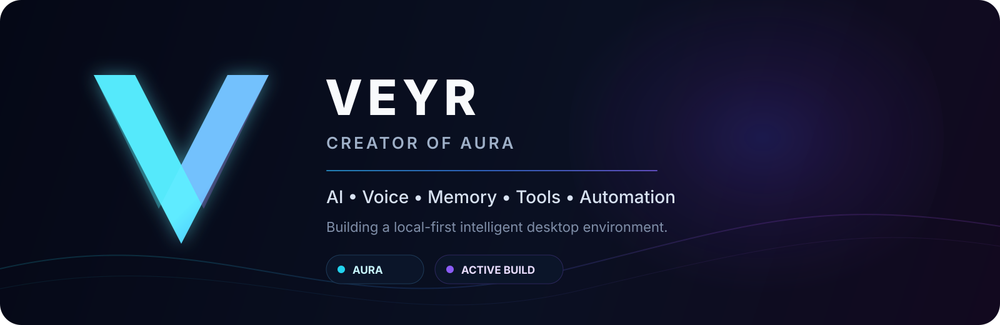
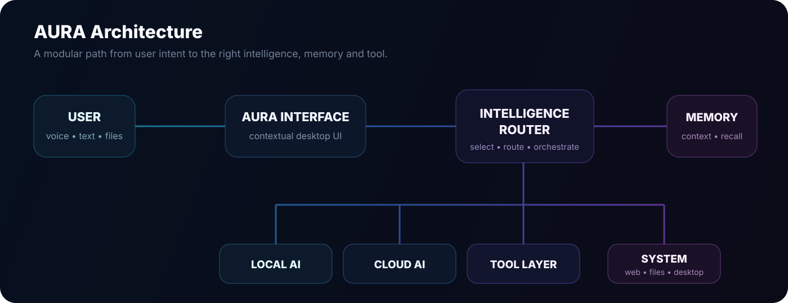

# Veyr — Building AURA

**Native Windows AI experiences · Local-first architecture · Human-centered interaction**

## About / À propos

I'm **Veyr**, an independent software creator developing **[AURA — Neural Operating Interface](https://github.com/VeyrNova/AURA)**, a local-first AI desktop assistant for Windows.

Je développe **AURA**, un assistant IA natif pour Windows qui réunit conversation, mémoire, vision, voix et outils dans une interface cohérente, avec une attention particulière portée au contrôle utilisateur.

> **One interface. Multiple intelligences. One assistant.**

## AURA — October 2026 / Octobre 2026

**Development preview — not yet a public installer release.**

The project has evolved from earlier experimental UI work toward a **native PySide6 / Qt Quick / QML Windows application** with a dark Liquid Glass design.

| Area / Domaine | Current state / État |
|---|---|
| Native Windows UI | Actively developed; manually tested on Windows 11 |
| Conversation & providers | Configurable provider routing; availability depends on user setup |
| Memory & Vision | Native services and tested image understanding workflow |
| Voice / Voix | Push-to-Talk input; French output tested with an **external** local Piper runtime |
| Windows packaging | Internal install, uninstall and reinstall cycle manually validated |
| Public downloadable beta | **Not released yet**; standalone acceptance and dependency review ongoing |
| FR / EN | Interface, installer and selectable voice languages on the roadmap |

The latest **local** Nuitka build is an internal test artifact, not a published GitHub Release. A future public prerelease will be explicitly labeled, with known limitations and file checksums.

**Le code public peut être en décalage avec les versions locales en cours de validation.** Une bêta installable sera annoncée uniquement lorsqu'elle aura passé les contrôles nécessaires.

### Explore / Découvrir

- **[AURA repository](https://github.com/VeyrNova/AURA)** — overview, development source and roadmap.
- **[Report a bug / Signaler un problème](https://github.com/VeyrNova/AURA/issues/new)** — feedback from Windows testers.
- **[GitHub Issues](https://github.com/VeyrNova/AURA/issues)** — proposals, questions and suggestions.
- **[Star AURA ⭐](https://github.com/VeyrNova/AURA)** — follow the project and improve its visibility.

## Core ideas / Principes

| Local first | Configurable intelligence |
|---|---|
| User-controlled local data and optional offline capabilities | External providers and local models are user-selected, not hard-coded requirements |

| Native experience | Reliability before release |
|---|---|
| Qt/QML desktop interface and integrated services | Measured tests, user-visible feedback, clean installation and removal |

## Architecture / Architecture

The software combines **Python**, **PySide6 / Qt**, native Windows integration and provider adapters. The user-facing application aims to make complex workflows accessible without hiding whether a capability is local, unavailable or requires an external provider.

## What I'm working on / Prochaines étapes

- French/English support across setup, interface, messages and voice selection.
- Official AURA app icon and cohesive Windows installer presentation.
- Independent Windows standalone tests with and without external speech components.
- Better onboarding, clear documentation and responsible public prereleases.
- User feedback loops through GitHub Issues and demonstrations.

## Previous research / Travaux précédents

The project has a substantial earlier history of browser/UI experiments, contextual memory, voice orchestration, performance research and developer tooling. Historical commits and technical notes remain available in the repository. The **current development focus is the native Windows app**, not the previous September 2026 Chromium runtime checkpoints.

## Source and licensing / Code et licence

The [AURA repository](https://github.com/VeyrNova/AURA) is publicly visible but is presently under an **All Rights Reserved proprietary license**. It is **not open source**, and using, copying or redistributing the code requires the applicable permissions. Feedback through Issues is welcome; any contribution must respect [AURA's contribution policy](https://github.com/VeyrNova/AURA/blob/main/CONTRIBUTING.md).

No personal credentials, local databases, conversation history, private media, user profiles or private runtime data should be published.

**VEYR × AURA**  
*Think. Route. Remember. Act.*

[GitHub](https://github.com/VeyrNova) · [AURA](https://github.com/VeyrNova/AURA) · [YouTube](https://youtube.com/@VeyrNova)

